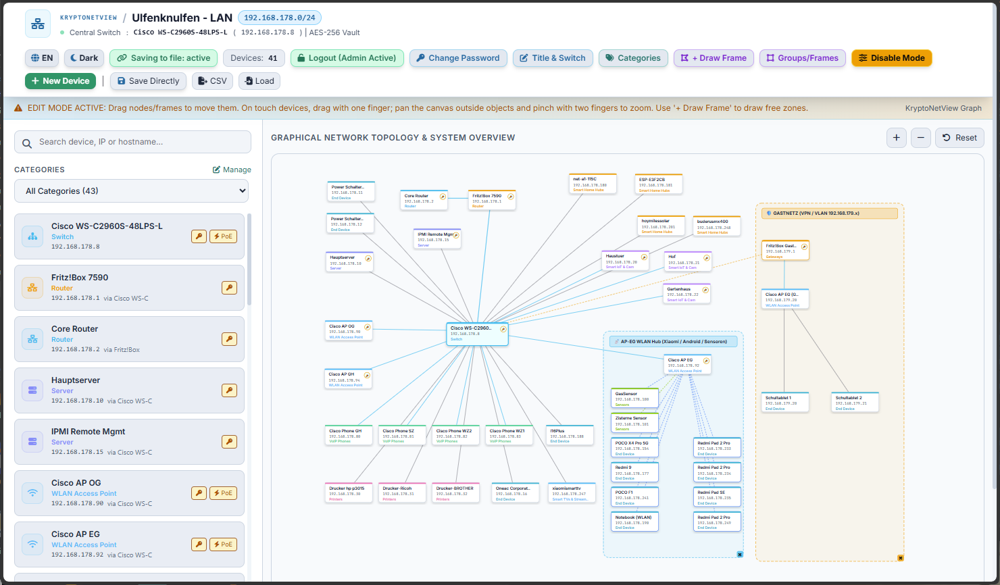
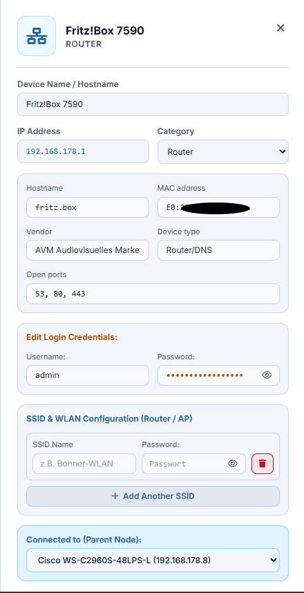
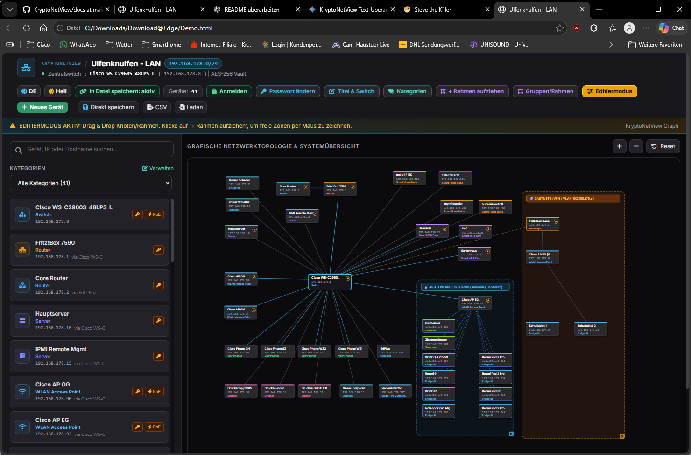
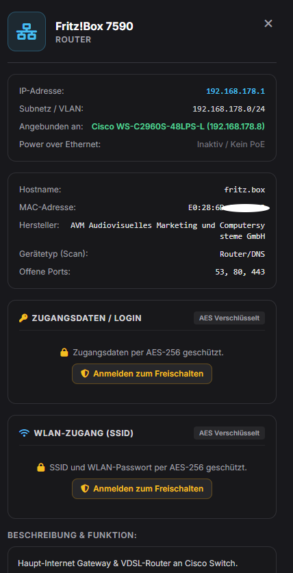

# KryptoNetView

**Offline-First Network Mapping · AES-256 Encryption · German & English**

---

## 🇬🇧 English

KryptoNetView is a self-contained, single-file HTML application for visualizing and managing network infrastructures. It features client-side AES-256 encryption, an interactive SVG canvas, a bilingual user interface, and CSV compatibility with Killerscan 1.8.3.

### 📸 Preview

| Main View | Detail View / Device Configuration |
|:---:|:---:|
|  |  |

### ✨ Key Features

- **Platform Independent:** Runs in modern web browsers on Windows, macOS, Linux, ChromeOS, and other supported platforms. No installation or additional runtime environment required.
- **Fully Bilingual:** Switch instantly between English and German with a single click.
- **Zero-Knowledge Security:** Data is encrypted locally in your browser using AES-256-GCM via the Web Crypto API. A master password is processed using PBKDF2. No cloud storage, tracking, or backend server.
- **Interactive SVG Canvas:** Move network devices, create custom zones and frames, visualize dynamic connections, zoom and pan across the network, and receive real-time visual feedback.
- **Single-File Application:** The application runs from a self-contained HTML file.
- **CSV Import & Export:** Back up, restore, and transfer network configurations using CSV files.
- **Killerscan Compatibility:** Import scan results generated by Killerscan 1.8.3 directly into KryptoNetView.
- **Flexible Device Management:** Manage routers, gateways, Wi-Fi access points, SSID configurations, switches, servers, and endpoints using customizable categories and status indicators.

### 🙏 Thanks to Killerscan

Special thanks to **Steve the Killer** for creating [Killerscan](https://github.com/SteveTheKiller/KillerScan).

Killerscan 1.8.3 can be used to scan a network and export the results as a CSV file, which can then be imported directly into KryptoNetView.

### 🔐 Security Model & Privacy

KryptoNetView follows a local-first, zero-knowledge approach:

- **Local Processing:** Cryptographic operations are performed in the browser using the Web Crypto API.
- **No Backend:** Network data does not need to be uploaded to a server.
- **No Password Recovery:** There is no server-side password reset mechanism. If you lose your master password, encrypted data may be permanently inaccessible.
- **User Responsibility:** Keep your master password and backups safe. Losing both access credentials and usable backups can result in permanent data loss.

### 🚀 Quick Start

1. Clone or download this repository:

   ```bash
   git clone https://github.com/ulfenknulfen/kryptonetview.git
   ```

2. Open the downloaded project directory.

3. Open `your_Project.html` to use the ready-to-use application, or `Demo.html` to start with the clean template.

4. Use a modern browser such as Chrome, Firefox, Edge, or Safari.

5. Unlock the administrator vault, configure your network, or import a compatible CSV file.

**Tip:** Keep regular backups of your network configuration and store your master password securely.

### ⚠️ Disclaimer

The software is provided "as is", without warranty of any kind, express or implied. Use it at your own risk. The author assumes no liability for data loss, system damage, or other consequences resulting from the use of this software, to the extent permitted by applicable law.

### 📄 License & Terms of Use

KryptoNetView is distributed under the project's customized license terms.

- **Private Use:** Free for private, non-commercial use.
- **Modifications:** Modifications are subject to the terms specified in the `LICENSE` file.
- **Redistribution:** Republishing or redistributing the software requires prior agreement with the author, as specified in the `LICENSE` file.
- **Commercial Use:** Commercial use requires prior consultation and an agreement with the author. Voluntary donations are welcome but do not automatically grant commercial usage rights.
- **Attribution:** Please credit the original author, `ulfenknulfen`.

See the [`License.txt`](License.txt) file for the complete terms.

### 🔗 Repository

[github.com/ulfenknulfen/kryptonetview](https://github.com/ulfenknulfen/kryptonetview)

---

## 🇩🇪 Deutsch

KryptoNetView ist eine autarke Single-File-HTML-Anwendung zur Visualisierung und Verwaltung von Netzwerkinfrastrukturen. Sie bietet AES-256-Verschlüsselung direkt im Browser, eine interaktive SVG-Zeichenfläche, eine zweisprachige Benutzeroberfläche und CSV-Kompatibilität mit Killerscan 1.8.3.

### 📸 Vorschau

| Gesamtansicht | Detailansicht / Geräte-Konfiguration |
|:---:|:---:|
|  |  |

### ✨ Hauptmerkmale

- **Plattformunabhängig:** Läuft in modernen Webbrowsern unter Windows, macOS, Linux, ChromeOS und anderen unterstützten Plattformen. Keine Installation oder zusätzliche Laufzeitumgebung erforderlich.
- **Vollständig zweisprachig:** Sofortiger Wechsel zwischen deutscher und englischer Benutzeroberfläche per Mausklick.
- **Zero-Knowledge-Sicherheit:** Die Daten werden direkt im Browser mittels AES-256-GCM über die Web Crypto API verschlüsselt. Das Master-Passwort wird mithilfe von PBKDF2 verarbeitet. Keine Cloud-Speicherung, kein Tracking und kein Backend-Server.
- **Interaktive SVG-Zeichenfläche:** Netzwerkgeräte verschieben, eigene Zonen und Rahmen erstellen, dynamische Verbindungslinien anzeigen sowie die Ansicht zoomen und verschieben – mit direktem visuellem Feedback.
- **Single-File-Anwendung:** Die Anwendung läuft aus einer eigenständigen HTML-Datei.
- **CSV-Import und -Export:** Netzwerkkonfigurationen mithilfe von CSV-Dateien sichern, wiederherstellen und übertragen.
- **Killerscan-Kompatibilität:** Scan-Ergebnisse aus Killerscan 1.8.3 direkt in KryptoNetView importieren.
- **Flexible Geräteverwaltung:** Router, Gateways, WLAN-Access-Points, SSID-Konfigurationen, Switches, Server und Endgeräte mit anpassbaren Kategorien und Statusindikatoren verwalten.

### 🙏 Dank an Killerscan

Ein herzliches Dankeschön an **Steve the Killer** für die Entwicklung von [Killerscan](https://github.com/SteveTheKiller/KillerScan).

Mit Killerscan 1.8.3 lässt sich ein Netzwerk scannen und das Ergebnis als CSV-Datei exportieren. Diese Datei kann anschließend direkt in KryptoNetView importiert werden.

### 🔐 Sicherheitsmodell & Datenschutz

KryptoNetView verfolgt einen lokalen, datenschutzorientierten Zero-Knowledge-Ansatz:

- **Lokale Verarbeitung:** Kryptografische Operationen werden direkt im Browser mithilfe der Web Crypto API durchgeführt.
- **Kein Backend:** Die Netzwerkkonfiguration muss nicht auf einen Server hochgeladen werden.
- **Keine Passwortwiederherstellung:** Es gibt keine serverseitige Funktion zum Zurücksetzen des Passworts. Bei Verlust des Master-Passworts können verschlüsselte Daten dauerhaft unzugänglich werden.
- **Eigenverantwortung:** Bewahre dein Master-Passwort und deine Datensicherungen sicher auf. Gehen die Zugangsdaten und brauchbare Sicherungskopien verloren, kann ein dauerhafter Datenverlust die Folge sein.

### 🚀 Schnellstart

1. Klone das Repository oder lade es herunter:

   ```bash
   git clone https://github.com/ulfenknulfen/kryptonetview.git
   ```

2. Öffne das heruntergeladene Projektverzeichnis.

3. Öffne `your_Project.html` für die fertige Anwendung oder `Demo.html`, wenn du mit der leeren Startvorlage beginnen möchtest.

4. Verwende einen modernen Browser wie Chrome, Firefox, Edge oder Safari.

5. Entsperre den Administrator-Vault, konfiguriere dein Netzwerk oder importiere eine kompatible CSV-Datei.

**Tipp:** Erstelle regelmäßig Sicherungskopien deiner Netzwerkkonfiguration und bewahre dein Master-Passwort sicher auf.

### ⚠️ Haftungsausschluss

Die Software wird ohne jegliche ausdrückliche oder stillschweigende Garantie bereitgestellt. Die Nutzung erfolgt auf eigene Gefahr. Der Autor übernimmt, soweit gesetzlich zulässig, keine Haftung für Datenverluste, Systemschäden oder sonstige Folgen, die aus der Nutzung dieser Software entstehen.

### 📄 Lizenz & Nutzungsbedingungen

KryptoNetView wird unter den individuell angepassten Lizenzbedingungen des Projekts veröffentlicht.

- **Private Nutzung:** Kostenlose Nutzung für private, nicht-kommerzielle Zwecke.
- **Veränderungen:** Änderungen unterliegen den Bedingungen der Datei `LICENSE`.
- **Weiterveröffentlichung:** Eine erneute Veröffentlichung oder Weiterverbreitung der Software setzt die vorherige Zustimmung des Autors voraus, wie in der Datei `LICENSE` festgelegt.
- **Kommerzielle Nutzung:** Eine kommerzielle Nutzung erfordert eine vorherige Absprache und Vereinbarung mit dem Autor. Freiwillige Spenden sind willkommen, begründen jedoch nicht automatisch kommerzielle Nutzungsrechte.
- **Namensnennung:** Bitte nenne `ulfenknulfen` als ursprünglichen Autor.

Die vollständigen Bedingungen findest du in der Datei [`License.txt`](License.txt)

### 🔗 Repository

[github.com/ulfenknulfen/kryptonetview](https://github.com/ulfenknulfen/kryptonetview)
