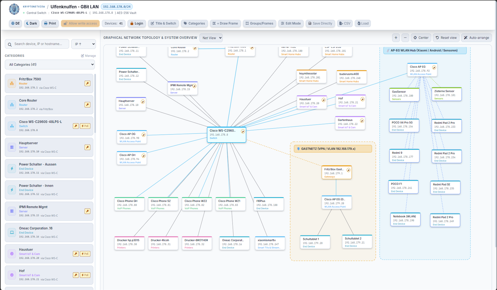
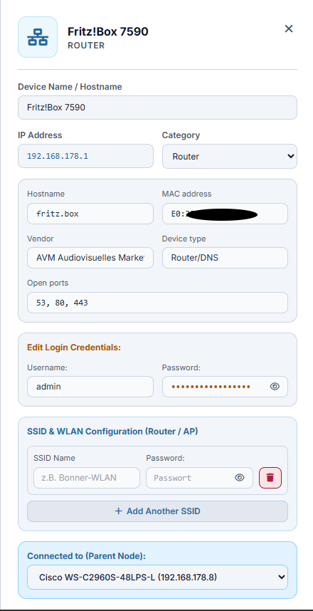
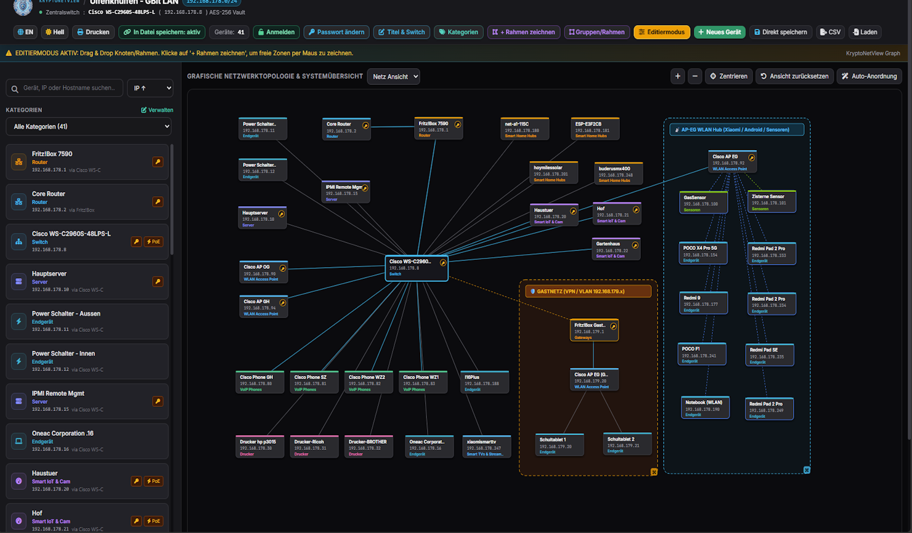
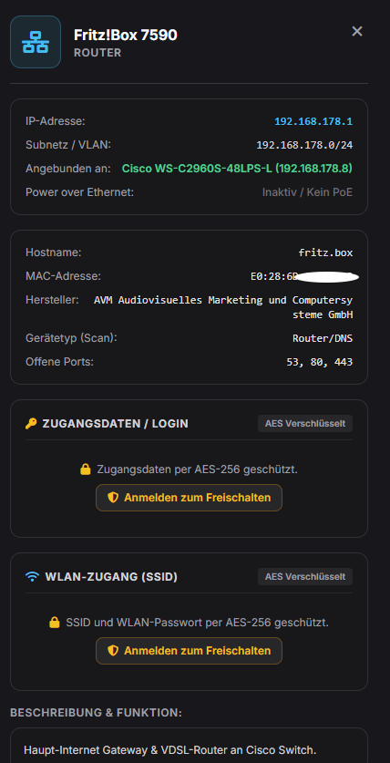

# KryptoNetView – Offline Network Mapping & Encrypted Network Documentation

**Offline-first network mapping and management · AES-256-GCM encryption · Network diagnostics · Print and export · German & English**

KryptoNetView is a self-contained, single-file HTML application for documenting, visualizing and checking network infrastructures. It runs locally in the browser and does not require a server, account or internet connection for its core functions.

The application combines an interactive SVG network map with device management, encrypted access data, subnet and IP address tools, network consistency checks, and printable network documentation.

---

## 🇬🇧 English

### Features

- **Offline-first, single-file application** – run KryptoNetView locally in a modern browser.
- **Interactive network map** – visualize devices and their connections on an SVG-based canvas.
- **Device documentation** – maintain device details, IP addresses, MAC addresses, categories, VLANs, notes and connection relationships.
- **Encrypted access data** – protect stored credentials with AES-256-GCM.
- **Network diagnostics** – check documented IP addresses, duplicate addresses and MAC addresses, subnet assignments, VLANs, connection relationships and DHCP ranges.
- **Subnet calculator and IP address tools** – calculate network ranges and inspect address usage.
- **Network report** – create a structured report from the documented network and its diagnostic results.
- **Print and export** – print the network map, device lists, categories, reports or other documentation views.
- **Bilingual interface** – German and English.
- **CSV compatibility** – compatible with CSV data from Killerscan 1.8.3.

### Screenshots

| Main view | FRITZ!Box example |
|---|---|
|  |  |

### Encryption and data protection

Stored device credentials are protected using **AES-256-GCM**.

The master password is processed using **PBKDF2 with SHA-256 and 600,000 iterations**. A random 128-bit salt is used. **HKDF-SHA-256** derives separate keys for encryption and password verification, so the same derived material is not reused for both purposes.

The authenticated encryption mode AES-256-GCM also provides integrity protection: changes to encrypted data are detected during decryption.

Older version 1 configurations are automatically migrated to the version 2 format after a successful login.

KryptoNetView performs its encryption locally in the browser. No master password or device credentials are sent to a server by the application.

**Important:** Local encryption does not protect data from malware, keyloggers, browser compromise or other attacks on the computer on which the application is running. Keep backups of important network documentation and protect the device itself.

### Network diagnostics

The network diagnostics examine the information documented in KryptoNetView. They can identify, among other things:

- Invalid IPv4 addresses.
- Duplicate IP addresses and duplicate MAC addresses.
- Device addresses outside the configured main subnet.
- Missing, invalid or self-referencing connection relationships.
- Devices without an assigned parent connection (with the root switch treated as an exception).
- Circular parent/child connection chains.
- Overlapping main and additional CIDR subnets.
- Subnet or VLAN inconsistencies between connected devices.
- Invalid DHCP ranges and conflicts between DHCP pools and documented device addresses.

The IP address tools also help inspect the configured address space, show occupied addresses and list available addresses within the main subnet.

**Diagnostic limitation:** These checks are based on the data entered into the application. KryptoNetView does not actively scan the network, ping devices or verify whether a device is currently reachable. Results therefore describe the consistency of the network documentation, not a live network scan.

### Network report, printing and export

KryptoNetView can generate a network report containing diagnostic results, device information and network statistics. The report is intended to make inconsistencies and the documented network structure easier to review and share.

Available print views include:

- Current view / visible network area.
- Device list.
- Devices grouped by category.
- Network report.
- Network map together with the device list.
- Full network documentation.
- Stored credentials (separate print view; administrator login required).

The network report does **not** include stored credentials. Credential printing is separated from the ordinary network report and requires an authenticated administrator session.

The print layout is prepared for paper output, including a light background for the network map and a suitable page orientation.

### Quick start

1. Download the HTML file.
2. Open it in a modern web browser.
3. Create or configure the administrator access as prompted.
4. Add devices and their network details.
5. Arrange the devices and document their connections on the network map.
6. Use the network diagnostics to check the consistency of the documented information.
7. Print or export the network documentation when needed.

KryptoNetView is designed to run locally. For important data, keep a separate backup of the HTML file and your network documentation.

### CSV compatibility

KryptoNetView supports CSV data compatible with Killerscan 1.8.3. Check imported data after import and correct any information that does not match your actual network.

Project repository: [github.com/ulfenknulfen/kryptonetview](https://github.com/ulfenknulfen/kryptonetview)

### Acknowledgements

Thanks to the developers and contributors of [Killerscan](https://github.com/SteveTheKiller/KillerScan) for their work and for the CSV compatibility that helps with importing network information.

### Disclaimer

KryptoNetView is a documentation and network-planning tool. Its diagnostic functions evaluate the information entered by the user; they do not replace professional network monitoring, security auditing or a live infrastructure scan.

The user is responsible for the accuracy of the documented data, the protection of the computer on which the application is used, and the creation of suitable backups.

### License & Terms

See [License.txt](License.txt) in the repository.

### Repository

[KryptoNetView on GitHub](https://github.com/ulfenknulfen/kryptonetview)

---

## 🇩🇪 Deutsch

### Funktionen

- **Offline-fähige Einzeldatei** – KryptoNetView läuft lokal in einem modernen Webbrowser.
- **Interaktive Netzwerkkarte** – Darstellung von Geräten und ihren Verbindungen auf einer SVG-Zeichenfläche.
- **Gerätedokumentation** – Verwaltung von Gerätedaten, IP-Adressen, MAC-Adressen, Kategorien, VLANs, Notizen und Verbindungsbeziehungen.
- **Verschlüsselte Zugangsdaten** – gespeicherte Zugangsdaten werden mit AES-256-GCM geschützt.
- **Netzwerkprüfung** – Prüfung dokumentierter IP-Adressen, doppelter IP- und MAC-Adressen, Subnetze, VLANs, Verbindungen und DHCP-Bereiche.
- **Subnetz-Rechner und IP-Werkzeuge** – Berechnung von Netzwerkbereichen und Prüfung der Adressbelegung.
- **Netzwerkbericht** – strukturierter Bericht mit den dokumentierten Netzwerkdaten und den Ergebnissen der Netzwerkprüfung.
- **Drucken und Export** – Ausgabe der Netzwerkkarte, Gerätelisten, Kategorien, Berichte und weiterer Dokumentationsansichten.
- **Zweisprachige Oberfläche** – Deutsch und Englisch.
- **CSV-Kompatibilität** – kompatibel mit CSV-Daten aus Killerscan 1.8.3.

### Screenshots

| Hauptansicht | FRITZ!Box-Beispiel |
|---|---|
|  |  |

Projekt-Repository: [github.com/ulfenknulfen/kryptonetview](https://github.com/ulfenknulfen/kryptonetview)

### Verschlüsselung und Datenschutz

Gespeicherte Geräte-Zugangsdaten werden mit **AES-256-GCM** verschlüsselt.

Das Master-Passwort wird mit **PBKDF2 und SHA-256 bei 600.000 Iterationen** verarbeitet. Dabei kommt ein zufälliger 128-Bit-Salt zum Einsatz. Über **HKDF-SHA-256** werden getrennte Schlüssel für die Verschlüsselung und die Passwortprüfung abgeleitet. Dadurch wird dasselbe abgeleitete Schlüsselmaterial nicht für beide Aufgaben wiederverwendet.

AES-256-GCM bietet zusätzlich zur Verschlüsselung eine Integritätsprüfung. Veränderungen an den verschlüsselten Daten werden beim Entschlüsseln erkannt.

Ältere Konfigurationen im Format Version 1 werden nach erfolgreicher Anmeldung automatisch in das Format Version 2 migriert.

Die Verschlüsselung erfolgt lokal im Browser. KryptoNetView überträgt weder das Master-Passwort noch die gespeicherten Geräte-Zugangsdaten an einen Server.

**Wichtig:** Die lokale Verschlüsselung schützt nicht vor Schadsoftware, Keyloggern, einem kompromittierten Browser oder anderen Angriffen auf den verwendeten Computer. Sichere deshalb auch das Gerät selbst und erstelle regelmäßig Sicherungskopien deiner wichtigen Netzwerkdokumentation.

### Netzwerkprüfung

Die Netzwerkprüfung untersucht die in KryptoNetView dokumentierten Daten. Unter anderem können folgende Probleme erkannt werden:

- Ungültige IPv4-Adressen.
- Doppelt vergebene IP-Adressen und doppelte MAC-Adressen.
- Geräteadressen außerhalb des konfigurierten Haupt-Subnetzes.
- Fehlende, ungültige oder auf sich selbst verweisende Verbindungszuordnungen.
- Geräte ohne zugewiesene übergeordnete Verbindung (der Root-Switch ist davon ausgenommen).
- Kreisförmige Parent-/Child-Verbindungsstrukturen.
- Überschneidungen zwischen Haupt-Subnetz und zusätzlichen CIDR-Subnetzen.
- Abweichungen bei Subnetz oder VLAN zwischen verbundenen Geräten.
- Ungültige DHCP-Bereiche und Konflikte zwischen DHCP-Pools und dokumentierten Geräte-IP-Adressen.

Die IP-Werkzeuge unterstützen außerdem bei der Prüfung des konfigurierten Adressbereichs. Sie zeigen belegte Adressen und können freie Adressen innerhalb des Haupt-Subnetzes auflisten.

**Einschränkung der Prüfung:** Die Prüfung basiert ausschließlich auf den in der Anwendung hinterlegten Daten. KryptoNetView scannt das Netzwerk nicht aktiv, führt keine Ping-Abfragen durch und überprüft nicht, ob ein Gerät aktuell erreichbar ist. Die Ergebnisse bewerten daher die Konsistenz der Netzwerkdokumentation und sind kein Live-Netzwerkscan.

### Netzwerkbericht, Drucken und Export

KryptoNetView kann einen Netzwerkbericht mit Prüfergebnissen, Geräteinformationen und Netzwerkstatistiken erstellen. Damit lassen sich die dokumentierte Netzwerkstruktur und mögliche Unstimmigkeiten übersichtlich kontrollieren und weitergeben.

Für den Druck stehen unter anderem folgende Ansichten zur Verfügung:

- Aktuelle Ansicht bzw. sichtbarer Netzwerkausschnitt.
- Geräteliste.
- Geräte nach Kategorie.
- Netzwerkbericht.
- Netzwerkkarte zusammen mit der Geräteliste.
- Vollständige Netzwerkdokumentation.
- Gespeicherte Zugangsdaten (separate Druckansicht; Anmeldung als Administrator erforderlich).

Der Netzwerkbericht enthält **keine** gespeicherten Zugangsdaten. Der Ausdruck von Zugangsdaten ist vom normalen Netzwerkbericht getrennt und setzt eine authentifizierte Administratorsitzung voraus.

Das Drucklayout ist für die Ausgabe auf Papier optimiert. Dazu gehören unter anderem ein heller Hintergrund für die Netzwerkkarte und eine passende Seitenausrichtung.

### Schnellstart

1. Die HTML-Datei herunterladen.
2. Die Datei in einem modernen Webbrowser öffnen.
3. Den Administratorzugang wie vorgegeben einrichten bzw. konfigurieren.
4. Geräte und deren Netzwerkdaten hinzufügen.
5. Die Geräte auf der Netzwerkkarte anordnen und ihre Verbindungen dokumentieren.
6. Mit der Netzwerkprüfung die Konsistenz der eingetragenen Daten kontrollieren.
7. Bei Bedarf die Netzwerkdokumentation drucken oder exportieren.

KryptoNetView ist für den lokalen Betrieb ausgelegt. Bewahre wichtige Daten zusätzlich in einer separaten Sicherungskopie auf.

### CSV-Kompatibilität

KryptoNetView unterstützt CSV-Daten, die mit Killerscan 1.8.3 kompatibel sind. Prüfe importierte Daten nach dem Import und korrigiere Angaben, die nicht mit dem tatsächlichen Netzwerk übereinstimmen.

### Danksagung

Vielen Dank an die Entwickler und Mitwirkenden von [Killerscan](https://github.com/SteveTheKiller/KillerScan) für ihre Arbeit und die CSV-Kompatibilität, die den Import von Netzwerkinformationen unterstützt.

### Haftungsausschluss

KryptoNetView ist ein Werkzeug zur Netzwerkdokumentation und Netzwerkplanung. Die Prüffunktionen bewerten die vom Benutzer eingetragenen Informationen. Sie ersetzen weder eine professionelle Netzwerküberwachung noch ein Sicherheitsaudit oder einen aktiven Scan der Infrastruktur.

Der Benutzer ist selbst für die Richtigkeit der dokumentierten Daten, den Schutz des verwendeten Computers und die Erstellung geeigneter Sicherungskopien verantwortlich.

### Nutzungsbedingungen

Siehe [License.txt](License.txt) im Repository.

### Repository

[KryptoNetView auf GitHub](https://github.com/ulfenknulfen/kryptonetview)
